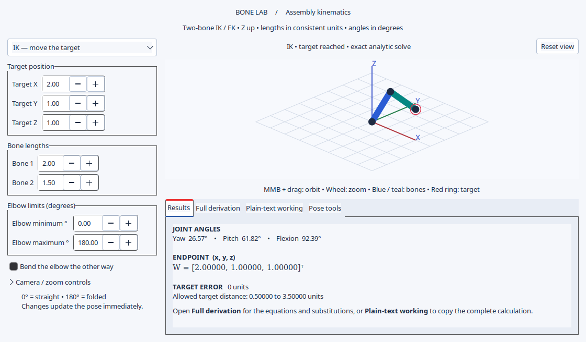

# Bone Lab — assembly IK + FK

A native Linux x86-64 calculator for **inverse and forward kinematics**, written
in GNU Intel-syntax assembly. A compact orthographic 3D bone view and mathematical results are stacked
vertically beside grouped settings. Hold the middle mouse button and drag to orbit.

The default **Results** tab shows joint angles, endpoint coordinates and IK error
without scrolling at the tested desktop sizes. The **Full derivation** tab uses native GTK/Pango labels with Greek symbols,
subscripts, superscripts, stacked fractions, vectors and a rotation matrix.
[Full IK worksheet](evidence/typeset-ik.png) · [Full FK worksheet](evidence/typeset-fk.png).
The **Plain-text working** tab retains a linear, selectable transcript. Displayed
decimals are rounded; the solver uses full-precision doubles. The mathematical
font is DejaVu Math TeX Gyre when available, with system font fallback. There is
no browser, TeX subprocess, downloaded font or remote rendering service.



## New pose and camera tools

- **Pose tools** adds a 64-snapshot Undo/Redo history and seven guided examples:
  reachable and unreachable targets, straight and folded singularities, the other
  elbow bend, a forward pose and a shoulder-limited search. Loading examples and
  applying search results are single undoable pose changes. Camera changes are
  independent. History stays in memory and resets when the app closes.
- **Shoulder-constrained search** scans 138,043 offline poses against the current
  target, bone lengths, elbow limits and bend direction, plus independent yaw and
  pitch bounds. Review the approximate error, then **Use sampled pose in FK**.
  Changing inputs invalidates that result until searched again. Empty narrow bounds
  mean no grid sample, not proof that a continuous solution is impossible.
- The grid is 5° yaw / 6° pitch / 6° flexion. The exact analytic IK solver remains
  separate and unrestricted at the shoulder. See [atlas model and ABI](docs/ATLAS.md).
- Scroll the wheel over the 3D view to zoom; smooth scrolling is proportional.
  **Camera / zoom controls** now includes Front, Side and Above views plus grid,
  axes and target visibility switches. Above is an 85° elevation, not a 90° top view.

### Source size, clearly separated

The repository contains **1,247,619 lines of .S assembly source** at this release:
**1,242,400 generated assembly-data source lines** and **5,219 non-generated
assembly source lines**. The generated file includes 1,242,387 meaningful `.double`
directives encoding the runtime-used atlas, rather than padding instructions.
This is not 1.2 million lines of handwritten algorithmic code. The read-only atlas
adds 9,939,096 bytes (about 9.48 MiB) to the native binary.

[Exact per-file accounting](docs/SOURCE_METRICS.json) is reproducible with
`python3 tools/source_metrics.py`. The atlas is reproducible with
`python3 tools/generate_atlas.py --check`. The source-size target does not replace
correctness, performance or security testing.

## Build and launch

Requires GCC/binutils, make, glibc, GTK 3, GDK 3, GLib/GObject, Cairo and libm.
Uses the distribution's installed libraries; no downloads or package installation
happen during build. Python 3 is needed only for tests and optional installation.

```sh
make
make check
./build/bone-ik
```

This release targets Linux x86-64 / System V ABI. It was tested on Debian 13.
It does not support Windows, macOS, ARM, arbitrary skeleton files or hardware
robot control.

## Use

- **IK:** edit target X/Y/Z, bone lengths and elbow limits. The shoulder is at
  the origin. The red ring is the requested target; the dark endpoint is the
  computed wrist. A residual line connects them when the target is unreachable.
- **FK:** choose “FK — set joint angles,” then edit shoulder yaw, shoulder pitch
  and elbow flexion. Only the active mode’s inputs are shown. Angles directly determine the
  elbow and wrist positions; out-of-limit flexion is rejected, not silently changed.
- **Bend the elbow the other way** selects the other bend direction. Switching modes
  uses that mode's retained input values; it does not copy the previous solution.
- **Hold middle mouse + drag** over the view to orbit the 3D camera. Horizontal
  movement wraps around; vertical movement stops at ±85°. Release stops rotation.
  **Reset view** restores azimuth −45°, elevation 25° and zoom 1× without changing
  the pose. Left-button dragging does not rotate.
- Expand **Camera / zoom controls** for keyboard-editable azimuth, elevation and
  zoom. These change only the view, without rerunning the solver. Alt plus an
  underlined label focuses a field; camera controls remain available without a mouse.
- Settings are grouped into target or angles, bone lengths and elbow limits. The
  sidebar scrolls independently on short windows. **Results** is compact; choose
  **Full derivation** or **Plain-text working** for every calculation step.
- The coordinate convention is **Z up**, right-handed world coordinates, arbitrary
  consistent length units. Grid spacing is one unit. Angles in controls are degrees;
  trigonometric calculations use radians. Flexion is 0° straight and 180° folded.
- The projection is orthographic wireframe, without perspective, solid occlusion
  or collision simulation. Large targets/zoom can be outside the viewport; zoom
  out or rotate to inspect them. The math still contains the exact coordinates.

## Mathematical model

Two rigid, zero-thickness bones, unrestricted shoulder yaw and pitch, one elbow
hinge with selectable bend sign `b = ±1`. Elbow constraints are the only joint
limits. The task is endpoint position, not wrist orientation or anatomical motion.

For target `(x,y,z)`, lengths `a,bone2` (called `L1,L2` in the app):

```text
rho = hypot(x,y); r = hypot(rho,z)
yaw = atan2(y,x); beta = atan2(z,rho)
c_raw = (r²-L1²-L2²)/(2 L1 L2)
phi = clamp(acos(clamp(c_raw,-1,1)), min_flexion, max_flexion)
delta = bend_sign * atan2(L2 sin(phi), L1+L2 cos(phi))
pitch = beta + delta
q2 = pitch - bend_sign*phi
E = L1 * (cos(pitch)cos(yaw), cos(pitch)sin(yaw), sin(pitch))
W = E + L2 * (cos(q2)cos(yaw), cos(q2)sin(yaw), sin(q2))
residual = hypot(Wx-x, Wy-y, Wz-z)
```

This is an **analytic evaluation, not an iterative solver**. There is no fictional
convergence graph or iteration count. The full derivation is the law of cosines:
`r² = L1² + L2² + 2 L1 L2 cos(phi)`; isolating `cos(phi)` produces `c_raw`.
The shoulder correction is the angle of vector
`(L1+L2 cos(phi), L2 sin(phi))`. FK applies the last three equations directly.

The admissible radial interval is `[d(max_flexion), d(min_flexion)]`, where
`d(phi)² = L1²+L2²+2 L1 L2 cos(phi)`. The implementation evaluates phi with the algebraically equivalent stable half-angle
formula shown in the app, and computes radial limits with
`hypot(L1-L2, 2 sqrt(L1 L2) cos(phi/2))` to avoid cancellation near folding.
Clamping flexion gives the closest radial
endpoint under this unrestricted-shoulder model. The app verifies the reconstructed
endpoint numerically and says reached only when absolute residual is at most `1e-8`.
A feasible target whose residual exceeds tolerance is labeled a numerical precision
limit rather than unreachable.

At the exact Z axis, IK chooses yaw 0; at the origin, beta 0. At the equal-length
fully folded origin the deterministic branch tends to pitch ±pi/2. These are
nonunique poses. Near-axis (`rho <= 1e-8`) and straight/folded
(`abs(sin(phi)) <= 1e-8`) states are explicitly flagged. Floating-point rounding
can make near-boundary results differ by a few ulps. No temporal continuity or
physical safety guarantees are implied.

Background: [CMU two-link kinematics](https://courses.ideate.cmu.edu/16-375/f2026/text/reference/two-link-kinematics.html).
UI references: [GTK 3 DrawingArea](https://docs.gtk.org/gtk3/class.DrawingArea.html)
and [Pango native text markup](https://docs.gtk.org/Pango/pango_markup.html).
Implementation and illustrations are original; no private Bridge source is included.

## Tests

```sh
make check       # solver, projection, pose-history, atlas oracles and source accounting
make ui-check    # needs an accessible display; offscreen windows only
make install-check  # isolated temporary-home install / upgrade / rollback tests
make pointer-check  # synthetic GDK events; requires Python PyGObject + GTK 3 typelib
make features-check # history, examples, atlas application and camera UI integration
make check-all      # all build/numerical/UI/install checks; needs an accessible display
```

The fixture returns 77 if no display is available. UI tests use native control
signals, IK/FK mode changes, invalid constraints and unreachable targets; PNGs
are written to `evidence/`. They do not launch a visible application window or move the physical pointer.
The event test verifies middle-button routing, left-button rejection, motion beyond
the canvas boundary, release, repeated drags, reset and scroll-free Results.
Native gesture-signal checks also cover cancellation and camera wrap/clamp.
See [verification](docs/VERIFICATION.md) and [security](SECURITY.md).

## Optional desktop installation

```sh
python3 tools/install.py
```

Installs the built program and a launcher under your user directories, including
`~/Desktop/Bone-Lab.desktop`. No root access, autostart, network, permissions
relaxation or automatic app launch. Existing different files are refused.
To update an existing install, explicitly name its 16-character version identifier:

```sh
python3 tools/install.py --replace-version OLD_VERSION
# Roll back the launchers without rebuilding or stopping the running application:
python3 tools/install.py --activate-version OLD_VERSION --replace-version NEW_VERSION
```

The identifiers are printed on installation and are the directory names beneath
`~/.local/lib/bone-lab/`. Only exact matching old launchers are replaceable. Previous
binaries remain installed for rollback; an already-running process is untouched.
Each launcher replacement is atomic, but the pair is not a cross-file transaction.
An interrupted update may leave launchers on different versions; rerun the same
command to reconcile them. Uninstall: `python3 tools/install.py --uninstall`
removes only exact files matching the currently built version; it does not remove
older binaries. An empty version directory can remain.

## Assembly API

`ik_solve(input,output)` and `fk_solve(input,output)` return 1 for accepted input,
0 for invalid numeric input (output zeroed). Callers provide separate valid,
nonoverlapping arrays: eight input doubles and 200 output bytes. Null pointers,
overlapping/undersized arrays are outside the ABI contract. See `src/layout.inc`.
Input order is `x,y,z,L1,L2,min,max,branch`; FK replaces x/y/z with yaw/pitch/phi.
Angles are radians; `branch` must be exactly +1 or -1. All numeric magnitudes
must be <=1e6, lengths >=0.001, and `0<=min<=max<=pi`. UI bounds are tighter.
Output slots are documented by named offsets; `FLAGS` is a uint64, not a double:
bit 0 target outside radial limits by more than 1e-8, bit 1 near-axis,
bit 2 near-straight/folded, bit 3 feasible geometry but residual > 1e-8. In FK,
IK-only intermediates (`RAW,C,CP,ELEV,DELTA,NUM`) are not meaningful. The public
routines are reentrant; GTK application state is confined to its main thread.
